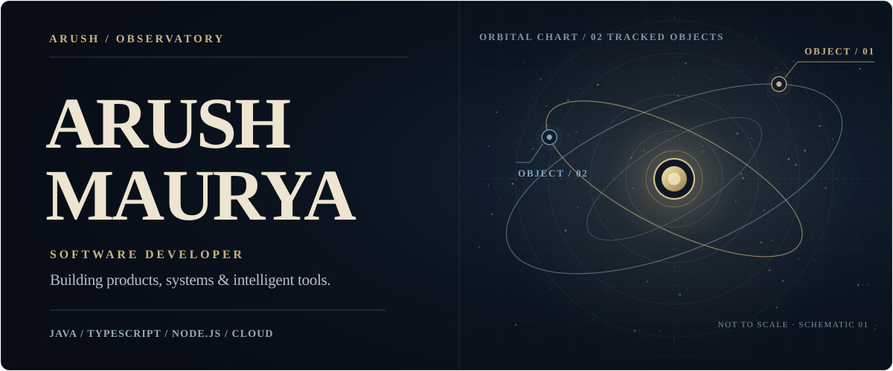
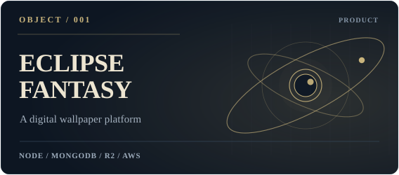
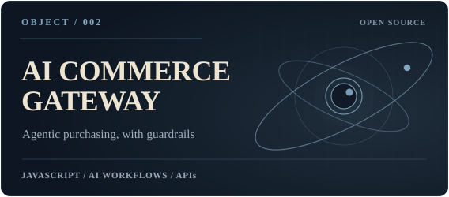
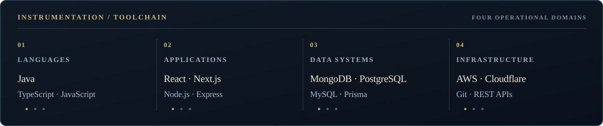

<p align="center">
  
</p>

<p align="center">
  <strong>Software developer building thoughtful products, reliable backends, and intelligent tools.</strong><br />
  <sub>Java · TypeScript · Full-stack engineering · Cloud infrastructure</sub>
</p>

<p align="center">
  <a href="https://eclipsefantasy.art">Explore Eclipse Fantasy</a>
  &nbsp;·&nbsp;
  <a href="https://github.com/Arush1901?tab=repositories">Browse repositories</a>
  &nbsp;·&nbsp;
  <a href="#03--instrumentation">Technical stack</a>
</p>

---

### `01 / OBSERVER PROFILE`

I’m **Arush Maurya**, a software developer interested in what happens when good product design meets solid engineering. I build across the stack—from interfaces and backend APIs to databases, authentication, deployment, and AI-driven workflows.

Currently focused on **Eclipse Fantasy** and exploring practical applications of **agentic systems**, **cloud infrastructure**, and **developer tooling**.

```yaml
observer: Arush Maurya
specialization: Software Development
primary_language: Java
focus:
  - Full-stack products
  - Backend systems and APIs
  - AI-powered applications
approach: Build it. Ship it. Improve it.
```

### `02 / OBJECTS IN ORBIT`

Two projects currently in the observatory’s field of view.

<table>
  <tr>
    <td width="50%" valign="top">
      <a href="https://eclipsefantasy.art">
        
      </a>
      <br />
      <b>Eclipse Fantasy</b><br />
      A full-stack wallpaper platform involving accounts, premium content, media processing, cloud storage, and deployment.
      <br /><br />
      <a href="https://eclipsefantasy.art"><b>Visit live website ↗</b></a>
    </td>
    <td width="50%" valign="top">
      <a href="https://github.com/Arush1901/AI-Commerce-Gateway">
        
      </a>
      <br />
      <b>AI Commerce Gateway</b><br />
      A goal-first agentic commerce gateway designed around bounded purchasing permissions and auditable transactions.
      <br /><br />
      <a href="https://github.com/Arush1901/AI-Commerce-Gateway"><b>Explore repository ↗</b></a>
    </td>
  </tr>
</table>

### `03 / INSTRUMENTATION`

The languages, frameworks, and systems I use to turn ideas into working software.

<p align="center">
  
</p>

### `04 / MISSION NOTES`

- **Building products:** End-to-end applications that people can actually use.
- **Engineering beyond localhost:** APIs, databases, media pipelines, cloud storage, and deployment.
- **Exploring intelligent systems:** AI-powered workflows, automation, and practical agent design.

### `05 / SIGNAL ROUTING`

**GitHub:** [github.com/Arush1901](https://github.com/Arush1901)  
**Live project:** [eclipsefantasy.art](https://eclipsefantasy.art)

<!-- Optional: add verified LinkedIn, email, or portfolio URLs here.
**LinkedIn:** https://www.linkedin.com/in/YOUR-SLUG/
**Email:** mailto:YOUR_EMAIL@example.com
-->

---

<p align="center">
  <sub>END OF TRANSMISSION · ARUSH / SYSTEMS OBSERVATORY</sub><br />
  <sub>Always in development.</sub>
</p>
