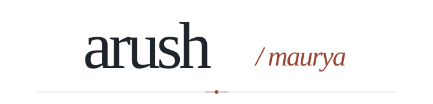
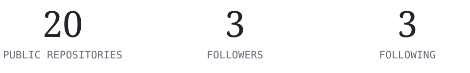

SELECTED WORK &amp; ONGOING CURIOSITY

  <picture>
    <source media="(prefers-color-scheme: dark)" srcset="./assets/folio-wordmark-dark.svg" />
    
  </picture>

  <picture>
    <source media="(max-width: 600px) and (prefers-color-scheme: dark)" srcset="./assets/folio-note-mobile-dark.svg" />
    <source media="(max-width: 600px)" srcset="./assets/folio-note-mobile-light.svg" />
    <source media="(prefers-color-scheme: dark)" srcset="./assets/folio-note-dark.svg" />
    
  </picture>
   Full-stack development · AI-powered tools · Always learning

  <a href="https://eclipsefantasy.art">Eclipse Fantasy ↗</a> &nbsp; / &nbsp;
  <a href="https://github.com/Arush1901?tab=repositories">GitHub ↗</a> &nbsp; / &nbsp;
  <a href="https://www.linkedin.com/in/arush-maurya-016858312">LinkedIn ↗</a> &nbsp; / &nbsp;
  <a href="mailto:arushmaurya736@gmail.com">Email ↗</a>

 

<picture>
  <source media="(max-width: 600px) and (prefers-color-scheme: dark)" srcset="./assets/01-about-mobile-dark.svg" />
  <source media="(max-width: 600px)" srcset="./assets/01-about-mobile-light.svg" />
  <source media="(prefers-color-scheme: dark)" srcset="./assets/01-about-dark.svg" />
  
</picture>

I’m **Arush Maurya**, a CSE student at **Chandigarh University (2023–2027)**. I build full-stack products and explore agentic AI.

**Currently building:** Eclipse Fantasy & AI Commerce Gateway. 
**Along the way:** 200+ LeetCode problems · SIH national-round selection.

 

<picture>
  <source media="(max-width: 600px) and (prefers-color-scheme: dark)" srcset="./assets/02-work-mobile-dark.svg" />
  <source media="(max-width: 600px)" srcset="./assets/02-work-mobile-light.svg" />
  <source media="(prefers-color-scheme: dark)" srcset="./assets/02-work-dark.svg" />
  
</picture>

<table>
  <thead><tr><th width="29%">Project</th><th>In a line</th></tr></thead>
  <tbody>
    <tr><td><strong>Eclipse Fantasy</strong> <a href="https://eclipsefantasy.art">Visit ↗</a></td><td>A premium 4K wallpaper platform with global delivery. Next.js · React · Cloudflare R2 / Workers</td></tr>
    <tr><td><strong>AI Commerce Gateway</strong> <a href="https://github.com/Arush1901/AI-Commerce-Gateway">Code ↗</a></td><td>Shopping agents with budget limits, negotiation, and an audit trail. Node.js · React · Groq · Razorpay</td></tr>
    <tr><td><strong>Smart AutoFill</strong></td><td>A Chrome extension for filling forms from saved profiles. JavaScript · Chrome APIs</td></tr>
  </tbody>
</table>

 

<picture>
  <source media="(max-width: 600px) and (prefers-color-scheme: dark)" srcset="./assets/03-toolkit-mobile-dark.svg" />
  <source media="(max-width: 600px)" srcset="./assets/03-toolkit-mobile-light.svg" />
  <source media="(prefers-color-scheme: dark)" srcset="./assets/03-toolkit-dark.svg" />
  
</picture>

<table>
  <tbody>
    <tr><td width="30%"><strong>Languages</strong></td><td>Java · JavaScript · TypeScript</td></tr>
    <tr><td><strong>Frontend</strong></td><td>React · Next.js · Tailwind CSS</td></tr>
    <tr><td><strong>Backend &amp; data</strong></td><td>Node.js · Express · PostgreSQL · MySQL · Prisma</td></tr>
    <tr><td><strong>Cloud &amp; tools</strong></td><td>Cloudflare · Git · Postman · Figma</td></tr>
  </tbody>
</table>

 

<picture>
  <source media="(max-width: 600px) and (prefers-color-scheme: dark)" srcset="./assets/04-activity-mobile-dark.svg" />
  <source media="(max-width: 600px)" srcset="./assets/04-activity-mobile-light.svg" />
  <source media="(prefers-color-scheme: dark)" srcset="./assets/04-activity-dark.svg" />
  
</picture>

<picture>
  <source media="(max-width: 600px) and (prefers-color-scheme: dark)" srcset="./assets/activity-mobile-dark.svg" />
  <source media="(max-width: 600px)" srcset="./assets/activity-mobile-light.svg" />
  <source media="(prefers-color-scheme: dark)" srcset="./assets/activity-dark.svg" />
  
</picture>

Public snapshot · 19 October 2026 
[More on GitHub ↗](https://github.com/Arush1901)

 

<picture>
  <source media="(max-width: 600px) and (prefers-color-scheme: dark)" srcset="./assets/05-contact-mobile-dark.svg" />
  <source media="(max-width: 600px)" srcset="./assets/05-contact-mobile-light.svg" />
  <source media="(prefers-color-scheme: dark)" srcset="./assets/05-contact-dark.svg" />
  
</picture>

[Email ↗](mailto:arushmaurya736@gmail.com) &nbsp; / &nbsp; [LinkedIn ↗](https://www.linkedin.com/in/arush-maurya-016858312) &nbsp; / &nbsp; [GitHub ↗](https://github.com/Arush1901)
